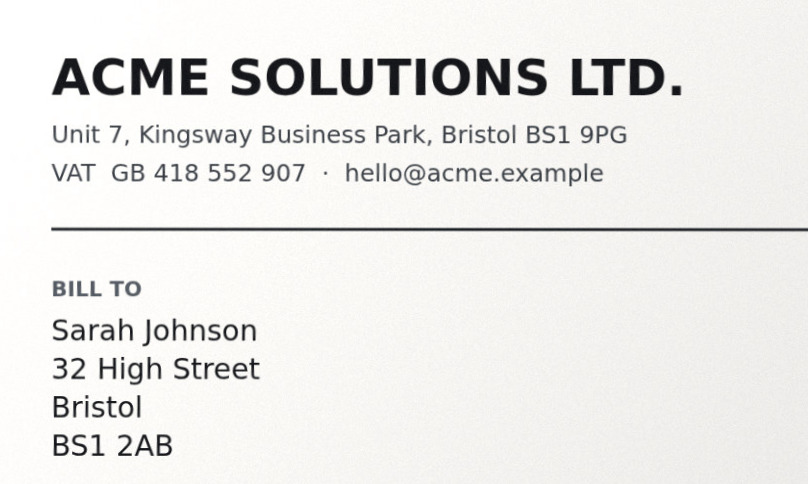
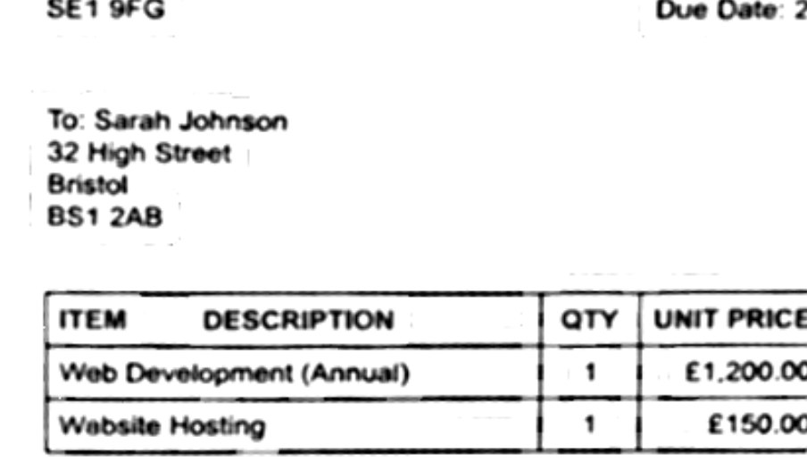

<p align="center">
  
</p>

<p align="center">
  <b>Photograph a document. Get a straight, clean, multi-page PDF.</b><br>
  No upload · no account · no install · Vue 3 + TypeScript, runs in the tab.
</p>

<p align="center">
  <a href="../../actions/workflows/ci.yml"></a>
  
  
  
  
</p>

---

**Live: <https://hpmine42.github.io/scano/>** — no install, no account.

You need one page as a PDF. So you take a phone photo — crooked, grey, a shadow
across the bottom, half the desk in frame — and every scanner app wants an
account and an upload.

Scano does the boring part properly, in the browser, and the photo never
leaves the device.

## Why it exists

Every scanner app wants an account, an upload, or a subscription — for a task
that is a perspective transform and a threshold. Scano is that transform and
that threshold, in ~7,000 lines of TypeScript, with the photo never leaving the
phone. MIT, no backend, no analytics, no CDN.

## Before / after

<table>
<tr>
<td width="50%"></td>
<td width="50%"></td>
</tr>
<tr>
<td align="center"><sub><b>Camera photo</b> — desk, shadow, 12° of skew</sub></td>
<td align="center"><sub><b>Scano</b> — straightened, shadows gone, text sharp</sub></td>
</tr>
</table>

A full page shrunk into a README column is not where you can judge a scanner, so
here is a strip at **100%** — the crop is 808 px wide, which is what GitHub
renders, so every pixel below is the pipeline's own:

<table>
<tr>
<td width="50%"></td>
<td width="50%"></td>
</tr>
<tr>
<td align="center"><sub>straightened, as photographed</sub></td>
<td align="center"><sub><i>Optimize</i> — ink mapping, not a threshold</sub></td>
</tr>
</table>

Both pictures come out of the app's own code: `npm run docs:images` renders a
3400×2550 photo of the demo sheet (what a phone hands the app), detects it, warps
it with the app's inset, runs *Optimize* with the app's own `OPTIMIZE` settings and
writes the four files. If a change ever makes the output worse, the pictures get
worse with it — which is exactly how the "the text looks bad" report was fixed:
the old `docs/detail.jpg` was a 2× blow-up of a 600 px page, and the pipeline
behind it really did break table rules into dashes.

## What it does

- **Optional live detection.** The *Detect* toggle is off by default; switched on,
  a worker finds the sheet ~2-3×/second and the outline eases into place.
- **The shutter is never a surprise.** If the viewfinder is already framing a
  sheet, that crop is used without asking. If it is not, Scano asks: crop by
  hand, detect this photo, or keep the whole frame — *Keep the whole photo* goes
  straight to the finished page, because the crop tool is exactly what it was
  just told not to use. Cropping stays one tap away in the page header.
- **Manual framing that actually lands.** Drag any corner with a magnifier loupe at
  2.6×, with **one small ring marking the exact pixel** under the corner — no
  crosshair arms, which would either cover the words you are lining the corner up
  with or pull the eye away from the centre — drawn in screen space on top of the
  magnified image (drawing it through the zoom transform is what once made it
  invisible). Or drag the whole sheet. The
  crop tool has exactly one button — *Done cropping* — and the page is rendered
  once on the way out, so dragging stays butter-smooth instead of warping a
  photo on every finger lift. A page that was turned is drawn turned here too:
  the corners you place are the corners you get (`src/lib/orient.ts`, where the
  two frames of reference are translated and tested).
- **"Keep the whole photo" is literal.** No hairline inset either. The page is
  the frame the camera saw, edge to edge, which matters the moment text runs to
  the paper's edge.
- **Find the page, and *see* it.** Pressing *Find the page* runs one amber band
  from the top of the photo to the bottom — a single pass, never a loop that
  stops wherever the detector happened to finish — then frames what it found and
  **stops**. Nothing is created until you choose: *Use this crop* or *Crop it
  myself*. A search that finds nothing says so and leaves the same three choices
  on the sheet instead of opening a tool nobody asked for.
- **Text you can search, without an upload.** *Find the text* reads the page with
  Tesseract compiled to WebAssembly, in a worker, from files served by this site —
  no CDN, no API, no request that leaves the tab. The words appear in a sheet you
  can select and copy, and go into the PDF as an **invisible text layer**: the
  page still looks like the scan, but a reader can search it, select a sentence,
  and copy the invoice number instead of retyping it.
- **One switch, no look-hunting.** *Optimize* is off by default, because the
  photo as taken is the honest starting point; switched on it flattens the
  lighting, whitens the paper and sharpens the text. It then appears in the dock
  of the finished page, not in the crop tool, where you are not looking at the
  picture yet.
- **The preview cannot freeze.** Phones kill camera tracks when they feel like
  it and leave a convincing last frame behind. The viewfinder measures whether
  frames are actually arriving, restarts the stream when the app comes back,
  and offers *Preview paused — tap to restart* if even that fails.
- **Your pages survive a reload.** They are kept in IndexedDB as JPEG blobs plus
  the crop, the look and the rotation — the pixels come back when you open a
  page, so a twenty-page session costs one database read at launch, not a twenty
  second wait. Nothing is uploaded, and *Clear* wipes it.
- **Ten photos at once, one at a time.** A batch from the library is opened
  lazily — one decoded photo in memory, the rest still files — and the sheet says
  how many are waiting. A file the browser cannot decode (an iPhone HEIC in
  Chrome, say) is named in the open instead of being skipped in silence.
- **Multi-page PDF** at up to 3000px per page — A4, US Letter, or a page that
  matches the scan exactly — with the file name typed in the app before saving.
  On a phone *Share* hands the PDF straight to the share sheet; the download is
  the fallback, not the plan.
- **Turn, reorder, fix.** A quarter turn lives in the header next to *Crop*, and
  the header gives way before a chip does: the counter shrinks first, so *Crop*
  is never half off the screen — which it was, from twelve pages on. Pages drag
  into another slot by their grip the way Google Keep moves a note: the card
  lifts into a preview under the finger, the grid reflows *while* you drag, and a
  dashed gap shows where it will land (the arrow keys move it too, and say where
  it went). The list auto-scrolls at the edges, and removing a page is undoable
  for six seconds. The drag listens on `window`, not on the card: moving a DOM
  node releases its pointer capture, so a handler on the grip died the moment the
  grid rearranged under it — which is exactly what "it hangs and cannot be
  dragged any more" was. The cards that give way slide into their new slot with
  the grid's own FLIP (`glideFrom`, 190 ms) rather than a `-move` class: Vue's
  move animation gives up when its *first* child has no transform transition,
  and the first child is by definition the dragged card — which removes its
  transition on purpose. So pulling the top page down moved nothing at all,
  while every other page glided. Letting go is a small flight, not a cut: the preview
  travels the last stretch into its slot (220 ms), the ring and the lift fade out
  on the way, and the real card takes over at the moment it arrives.
- **Tap to focus.** A tap always answers — ring where the finger was, plus a
  haptic — and asks the lens to focus there; where a browser cannot honour the
  point it falls back to a plain refocus, and if the lens cannot be asked at all
  it says so once instead of flashing a ring that means nothing. Plus an opt-in
  *Auto* shutter that fires
  once the outline has held still for most of a second — for when the phone is
  propped up and both hands are busy with the book.
- **Two pages in one photo** (an open book, two receipts): the detector looks
  for a second, non-overlapping sheet and, when it finds one, the review sheet
  shows both outlines and asks — *Scan both pages*, *Just the first one*, or
  *Crop it myself*, which opens the corners on the marked page. Finding two
  sheets is not a reason to take the crop tool away: when the outline itself is
  wrong, "scan both" and "scan half of it" are both the wrong answer.
- **Pinch to zoom in the viewfinder**, with 0.5× / 1× / 2× chips and a switch to
  the ultra-wide lens when the phone exposes one. Everywhere else the app holds
  pinch-to-zoom shut, because it only ever fights the user.
- **Light on first load.** The app shell is 53 kB gzipped; jsPDF and its
  dependencies (~370 kB) are fetched in the background while the camera is up —
  not at the moment of export, because a lazy chunk that was never fetched is
  exactly what makes "save" fail on a phone that has gone offline since.
  Data Saver and 2G links skip that warm-up.
- **Installable, and offline from the first visit.** Add it to the home screen
  and it opens with no network at all — the worker precaches *every file of the
  build*, and the list is written by the build (`vite.config.ts` walks `dist/`)
  rather than by hand. That is the whole difference between an app that works
  offline and one that only looks like it: a hand-kept list holds `index.html`
  while the hashed bundle it loads is missing, so a phone in flight mode gets a
  page that never boots — and the names change on every deploy anyway.
  With `navigator.onLine === false` the cache answers straight away (no waiting
  out a timeout to discover the obvious); with a connection the network wins, and
  only a slow one is cut off after 2.5 s and answered from the cache. If the
  install itself happens offline, the worker *fails* on purpose and the previous
  build keeps serving — a new worker must never delete the cache that works.
  The cache name is stamped with the build, so a deploy throws the old shell
  away, and the runtime cache is capped at 60 entries so hashed bundles cannot
  accumulate.

## Mobile first

One thumb, one hand: full-bleed viewfinder, 52px chips, a 96px shutter (the same
diameter as Google's camera), safe-area aware docks, `100dvh` layout and no
horizontal overflow. Every size is a token multiplied by `--u`, so the whole UI
can scale as one piece. The desktop-only "phone on a desk" frame is gated behind
`(hover: hover) and (pointer: fine)` so a real phone always gets the whole
screen.

Sizes are deliberately matched to Google's scanner: 96px shutter, 52px labelled
chips, 54px round buttons, 12.5px captions. On a 390px phone the camera's top
bar has to hold a wordmark and three labelled chips (Detect, Auto, Light), so
those chips drop to 46px there — still a comfortable target — and the row wraps
rather than letting the last chip run off the edge, which is what a fixed row
did before.

Some phones browse in "desktop site" mode, which reports a ~980px viewport on a
~410px screen and makes the browser paint everything at about 40%. `src/lib/fit.ts`
measures that mismatch and sets `--u`, so the UI comes out the right size anyway.
`?u=2.4` forces a scale by hand if a browser is being creative.

Two things about that measurement are worth knowing, because both were a bug on a
real phone:

- **A launch is not a measurement.** A PWA cold start can report the desktop
  layout width for the first frames, before the viewport meta is honoured. One
  sample taken then was a 2.4× UI for the rest of the session — "sometimes it
  opens bigger and you have to scroll" — because nothing fires a `resize` to
  correct it. The decision now needs corroboration (the visual viewport says the
  page really is painted small, or the visible width agrees with the layout
  width), and the reading is repeated after the app is up and whenever it comes
  back to the foreground, so a wrong boost takes itself back.
- **`100dvh` is not the visible height in a standalone app.** With the status bar
  over the page and the gesture bar below it, the layout can be a few dozen
  pixels taller than the screen: the document scrolls by that sliver and the top
  bar arrives with its chips cut off. The shell is sized from
  `visualViewport.height` (`--app-h`), capped at the viewport, and the document
  itself never scrolls — the lists inside do.

## How the pictures get good

A phone photo of a page is paper multiplied by the light falling on it, and that
light is never even. So `enhance()` works in this order:

1. **Flatten the illumination** — estimate the light as a heavy blur of the
   luma, then divide it out. Shadows stop being something the threshold has to
   fight, which is what used to leave grey blotches and grey paper.
2. **Stretch the levels** on the 2%–98.5% percentiles of the *lit* page,
   ignoring the tails.
3. **Sharpen** with an unsharp mask before anything decides black or white. A
   200 DPI photo of a sheet has hairlines about one pixel wide, and both the
   warp's interpolation and the smoothing below soften them into grey smudges;
   putting the edge back is what lets the mapping see a clean edge instead of
   having to guess. (The smoothing that follows touches only the *statistics* —
   the pixel being classified is never blurred.)
4. **Estimate the paper** with a maximum over small blocks: ink only ever makes a
   pixel darker than its paper, so the brightest value in a neighbourhood *is*
   the paper. A plain blur would be pulled down by the ink it covers, which
   hollows out letters — dark rim, pale middle.
5. **Map paper → ink** (B&W). One ink level for the page (the 1st percentile of
   the normalised image) and one paper value per pixel; a pixel's coverage is
   `(paper − pixel) / (paper − ink)`. A stroke centre lands at 100% ink, its
   antialiased edge at 50%, blank paper at 0% — and a one-pixel rule is *thin,
   not faint*, so it stays a rule everywhere along its length.

Step 5 has now been rewritten twice, and each rewrite came from a report about
text quality:

- The first version was a Sauvola threshold: compare the pixel with a local mean
  and decide black or white. Anything darker than its surroundings became *solid*
  black, so thin strokes fattened, neighbouring letters merged, and a scanned
  "rn" came out as an "m".
- The second mapped each pixel between the local **maximum and minimum** of a
  blurred copy. That is better, but not right: a window's maximum is a paper value
  where the window is empty and a grey value where a rule happens to fill it, so
  the same stroke came out black in one place and pale three lines further down,
  thin table rules dissolved into dashes, and a light grey table band flickered
  between "paper" and "ink".
- What is there now takes the paper *once* for the page and the ink *once* for the
  page, so a stroke has the same weight at the top edge of the sheet as at the
  bottom, a grey band is paper everywhere, and hairlines survive because nothing
  deletes a dark pixel for being one pixel wide.

The despeckle afterwards removes a lone *mid-grey* pixel — grain — and leaves a
lone black one alone, because that is a dot in the print, not noise.

Imports are read at up to 3600px, exports at 3000px, and neither is ever scaled
above what the photo actually contains. The *sample* was the other half of the
"the text looks bad" report, by the way: the demo photo put the sheet at 597 px,
where a line of body text is six pixels tall and every Optimize pass looks ragged.
`scripts/make-sample.ts` now composes the invoice at 200 DPI and photographs it at
2400×1800 for the app (the sheet 1750 px across, 210 DPI) and at 3400×2550 for the
README pictures. Anything that would exceed 8 megapixels
or 4096px on a side is rendered a little smaller on purpose: past those numbers
iOS Safari hands back a blank canvas instead of an error, and a blank page in a
PDF is worse than a page that is 20% smaller.

The editor renders its preview at about 1.35× the pixel size of the canvas it
draws into, and never beyond ~1.6× the page's own resolution. That ratio is the
whole difference between *crisp* and *blurry* for thresholded text: black and
white glyph edges survive a downscale badly, so the canvas wants more source
pixels than it has output pixels. (Sizing the preview by the stage's height
instead — which is what it used to do — rendered a page taller than the canvas
and squeezed it, and that is what made Optimize look softer than the photo.)

An export plans for failure, because a phone is a hostile place to build a 3000px
document. Each page is rendered, checked, and re-rendered smaller if the browser
handed back an empty canvas — the silent way a canvas past its memory limit
fails, and how a PDF full of blank pages used to happen. A page that cannot be
rendered at any size stops the export with a sentence that names the problem
instead of a shrug. Twenty pages share a smaller pixel budget than one, because
being killed halfway through a long export is the one failure there is no
recovery from. And the PDF itself is built when the grid goes idle: a phone only
lets you share a file for a few seconds after a tap, and a multi-page build takes
longer than that — with the file ready, Share opens instantly.

The crop is pulled in by 0.8%, because detection and hand-placed corners both
tend to sit a little outside the paper — that sliver of desk is the dark line
along the edge of an otherwise clean scan.

## How the detection works

No ML model and no WASM download — plain TypeScript in
[`src/lib/cv.ts`](src/lib/cv.ts). Three candidate sources feed one ranked list:

1. **Paperness masks at several thresholds** — bright, low chroma, red not far
   above blue. The warmth term keeps a wooden desk out; high percentiles of the
   luma histogram find a white sheet on a pale desk where Otsu fails. Printed
   text is closed away morphologically.
2. **Blob scoring** — each blob's minimum-area rectangle is scored on *fill*
   (does the rectangle actually match the blob?), *contrast* (is the inside
   brighter **or** less colourful than the outside?), *edge sharpness* and size.
3. **Edge snap from the frame** — for paper a colour mask cannot separate
   (white on white), four seed frames let each side slide onto the strongest
   paper-over-desk edge. Gates on movement, gradient and paper evidence keep an
   empty desk from being reported as a document.

The winner is then snapped precisely, checked against a second opinion from the
*unclosed* mask (closing glues a pen or a shadow to the sheet and inflates the
rectangle, the raw blob does not), warped with a homography and thresholded
with Sauvola. Colour is used throughout: a pale
wooden desk can match paper in brightness while being obviously different in
hue, which is exactly where a luma-only detector fails.

## Text, offline

Searchable PDFs usually mean a cloud OCR subscription, and on iOS/Android the
easy answer is Google's ML Kit — *"extract text instantly without internet
access"*. That promise is real, but ML Kit's on-device text recognition ships as
an **Android/iOS library**. There is no browser build of it: a web page cannot
call it, and the only thing on the web that would is a network request to a
service, which is the thing this app exists to avoid.

The browser equivalent — the same "no internet, nothing leaves the device"
promise — is [Tesseract](https://github.com/tesseract-ocr/tesseract) compiled to
WebAssembly, which is what runs here:

- **On this device, in a worker.** `tesseract.js` + the LSTM engine + the English
  model, served from `scano/ocr/` on the same origin. No CDN and no API: with the
  network unplugged, recognition still runs.
- **Fetched on the first tap, not on launch.** The engine is ~4.5 MB on the wire
  (a 1.4 MB gzipped WASM binary with the engine inlined, a 2.9 MB English model,
  a 34 kB worker). It is cached
  by the service worker's runtime cache, so the second page and every page after
  that — and every launch, offline included — costs nothing. People who never tap
  *Find the text* never download it, which is why the app still loads in 54 kB.
- **On the finished page.** The engine reads the warped, straightened page, and
  with *Optimize* on it reads the black-on-white version — the input it was tuned
  for. Measured on the demo photo: a whole invoice page in well under two seconds
  on a phone-class CPU, at ~1,800px on the long side (below that, letters merge
  and the output is fiction; above it, accuracy stops improving and the wait
  just grows).
- **As an invisible text layer.** Each word is written into the PDF at the spot
  it was found, at its own size and horizontal scale, in invisible render mode.
  The page looks exactly like the scan; the file is searchable, selectable and
  copyable. The text layer can be switched off per page, and a page without
  recognised text exports byte-for-byte as before. Recognised words survive a
  reload (they are a few kB, stored with the page) and are thrown away when the
  crop or the rotation changes, because their boxes would no longer be true.

Honest limits: it is English-only for now, handwriting is a coin flip, and a
blurred photo stays blurred — recognition reads what the pipeline produced, so
*Optimize* helps the text as much as it helps the eye.

## Run it

```bash
npm install
npm run dev        # http://localhost:5173
npm run build      # static site in dist/
npm run test:cv    # the CV pipeline, on the demo photo
npm run docs:images # regenerate the before/after pictures
```

`npm install`/`npm run dev`/`npm run build` also fetch the OCR engine into
`public/ocr/` (~6.5 MB, once per checkout, `npm run ocr:assets`) — it is not in
git, because cloning a repository should not mean downloading a language model.

If the browser blocks camera access (or you are on desktop), the app offers
**Demo photo** so the whole flow is still one tap away.

## Structure

```
src/components/   CameraView, CaptureReview, EditorView, CornerEditor, PagesView
src/lib/cv.ts     detection, homography warp, enhancement — no dependencies
src/lib/ocr.ts    text recognition in a worker; boxes normalised to the page
src/lib/pdf.ts    jsPDF layout; fitOnPage and textLayerRuns are pure and tested
src/lib/store.ts  pages, options, the preview/export resolution budgets
src/lib/orient.ts the photo frame ↔ the page frame, for turned pages
src/lib/storage.ts IndexedDB (with an in-memory twin the tests drive)
src/lib/share.ts  the share sheet, and the download it falls back to
src/lib/fit.ts    the UI scale that undoes a browser's desktop-mode shrink
scripts/          test-cv.ts (real pipeline), check-dist.mjs (deploy guard),
                  fetch-ocr-assets.mjs (the OCR engine), make-sample.ts (the demo
                  photo, composed at 200 DPI), make-demo.ts (the README pictures)
```

Nothing in `src/lib` sends anything anywhere: the text engine is fetched from
this site and runs in the tab. The service worker only caches the app's own files, which is why "works offline" is a property and not a promise.
The only thing that leaves the device is a PDF the user explicitly shares.

Offline is covered by `tests/offline.test.ts`, which runs the real `public/sw.js`
in a sandbox with a cache, a switchable network and the events a browser fires at
it: a cold launch with no connection, a launch on a network that accepts the
request and never answers, a launch with nothing cached at all (a real page, not
an error), an install that happens offline, and the deploy that must throw the
previous build away. `scripts/check-dist.mjs` then fails the build if the stamped
worker does not carry every bundle `index.html` needs.

## Tests

```bash
npm run typecheck  # vue-tsc, strict
npm run test:cv    # real CV pipeline on the demo photo, with assertions
npm run test:ocr   # the real text engine on the same page (114 words, ~2s)
npm test           # UI flows, detection on synthetic scenes, loupe maths, PDF geometry
```

`test:ocr` runs Tesseract for real: it reads `docs/after.jpg` and fails if the
invoice's number, its total or its payment terms are not in the output — a mocked
recogniser can prove the wiring, not that the shipped language model works.

`test:cv` is the honest one: it detects the page in `public/samples/letter.jpg`,
checks the corners against the coordinates the sample was *composed* with
(`scripts/make-sample.ts` prints them), and fails the build if the detector drifts.
`tests/optimize.test.ts` holds the Optimize pass to what a scanner has to do: a
one-pixel rule stays a rule, a stroke keeps its weight across a lamp gradient, a
grey band stays paper, and on the real demo photo every table rule is continuous
from one end to the other. `tests/detect.test.ts` renders synthetic desks — dark, warm,
low-contrast, empty — and asserts both the found corners and the *refusal* to
find a page where there is none. `tests/pdf.test.ts` covers the placement maths, because getting
that wrong prints cropped documents, `tests/geometry.test.ts` pins the
canvas → image mapping that the magnifier depends on, and
`tests/orient.test.ts` proves that cropping a turned page gives the same picture
as turning the photo and cropping there.

The B&W output runs a despeckle pass after the ink mapping: paper grain
and JPEG noise become visible dirt once a page is pure black and white, and
isolated pixels are not glyphs.

## Installing it as an app

Chrome/Android: open the site, tap **Install Scano** in the viewfinder. iOS: Share
→ *Add to Home Screen*. It then runs standalone, offline included.

### "It says it is already installed, and it will not open"

This is the one install failure that has nothing to do with the code. GitHub does
not redirect a project site after a repository is renamed: an app installed while
the site lived at `/scanner/` keeps a start address that now returns 404. Android
still lists the entry — so the install sheet says *already installed* — and
launching it fails, because there is nothing at that address any more.

The page detects that situation (`getInstalledRelatedApps()` against the
`related_applications` entry in the manifest) and offers **Fix the installed
app** with the two steps below. Doing it by hand works just as well:

1. Long-press the Scano icon → **App info** → **Uninstall**.
   No icon? **Settings → Apps → Scano → Uninstall**.
2. Reload the site and tap **Install Scano** again.

Only one install exists afterwards, and it points at the current address.

## Deployment

CI ([`.github/workflows/ci.yml`](.github/workflows/ci.yml)) runs on every push
to `main`, on every pull request, **on a daily schedule** and on demand. The
build job typechecks, runs both test suites and builds; the deploy job publishes
to GitHub Pages, then loads the live URL and checks that the served
`index.html` is the built one and that `manifest.webmanifest` and `sw.js`
resolve — a deploy that published nothing turns the run red instead of leaving a
white page.

`configure-pages` runs with `enablement: true`, so if Pages is not set up for a
fork, a renamed repository or a reset environment, the workflow creates it
itself instead of waiting for a manual click. Nothing about deployment depends
on a setting someone has to remember.

## Keyboard and desktop

The app is built for a thumb, but it is usable with a mouse: the corner editor
takes a drag with the magnifier following the pointer, `Escape` goes back to the
camera, and the desktop browser gets the same UI in a phone-sized frame (that
frame is a `(hover: hover) and (pointer: fine)` rule, never a mobile layout).

The four corners are also four real buttons sitting invisibly on top of the
drawn handles: Tab reaches them, the arrow keys move the focused corner by a
pixel (ten with Shift / Cmd), and the canvas draws the ring so you can see what
has focus. The page grips in the grid take arrow keys the same way.

## Roadmap

- OCR layer (tesseract.js) so exported PDFs are searchable
- Share-target on mobile (receive photos from other apps)
- Optional signature and redaction tools
- Per-page paper size, for the mixed-size scan

## License

MIT
