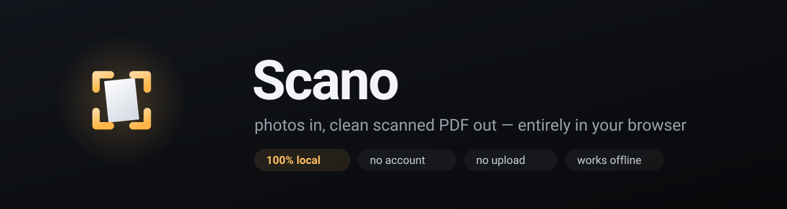
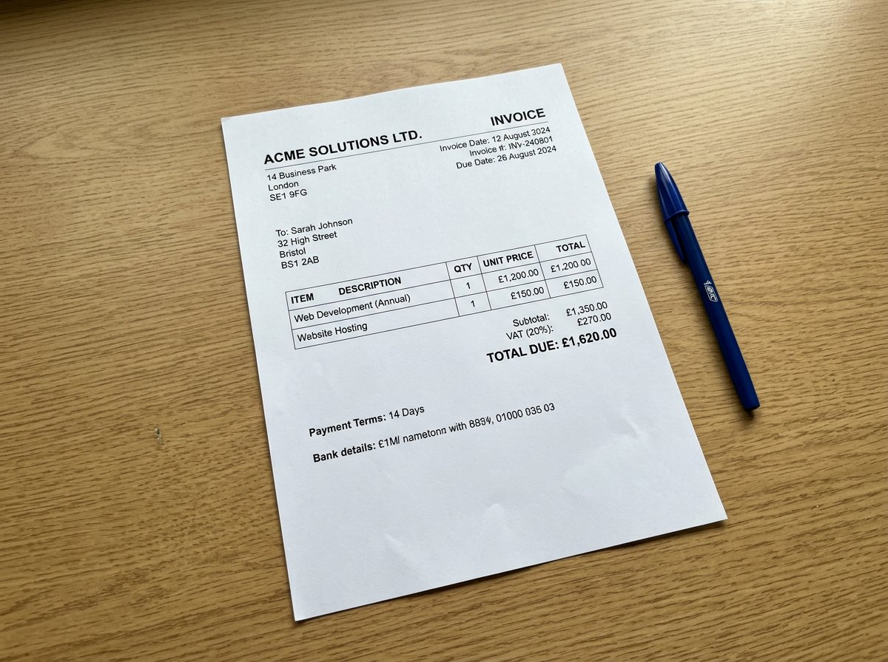
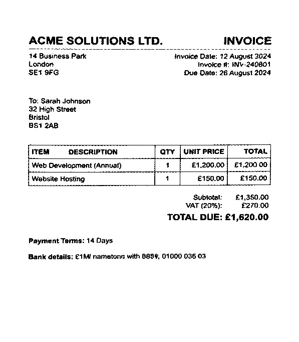

<p align="center">
  
</p>

<p align="center">
  <b>Photograph a document. Get a straight, clean, multi-page PDF.</b><br>
  No upload. No account. No install. Everything runs in the tab.
</p>

<p align="center">
  <code>open https://flatbed.app</code> · or press <kbd>Try the demo photo</kbd> and see it in two seconds
</p>

---

## The problem

You need one page as a PDF. So you take a photo with your phone, and now you have
a photo: crooked, grey, with a shadow across the bottom and half the desk in
frame. The scanner app you found wants an account and uploads your payslip to
someone's server.

`flatbed` does the boring part properly, and does it locally.

## What it does

| | |
|---|---|
| **Deskew + perspective** | Finds the sheet, snaps to the real paper edge, flattens it into a rectangle. |
| **Shadow removal** | Sauvola adaptive threshold instead of a global cutoff, so a shadow does not turn a page black. |
| **Clean B&W** | Text becomes black, paper becomes white — like a real scan, not like a filter. |
| **Multi-page PDF** | Stack photos, reorder, tune each page, export one A4/letter document. |
| **Nothing leaves the tab** | No fetch, no worker upload, no telemetry. Turn off the network and it still works. |

## Before / after

| Camera photo | flatbed |
|---|---|
|  |  |

*(this is the demo photo that ships with the app — click “Try the demo photo”)*

## How the detection works

No ML model, no WASM download, ~20 kB of code:

1. **Paperness mask** — bright, low-chroma, and red not far above blue. That last
   term is what keeps a warm wooden desk out of the mask.
2. **Morphological closing** — print punches holes into a sheet; without closing,
   a page is never one connected blob.
3. **Component scoring** — every blob is scored by how completely its
   minimum-area rectangle is filled. A page fills ~0.9; a bright patch of desk
   does not.
4. **Edge snapping** — each side is slid and tilted while measuring edge strength
   *and* polarity (paper brighter than the desk). Lines keep the coarse
   orientation, so corners stay sane when an edge is occluded.
5. **Homography warp** + Sauvola threshold for the output.

Everything is plain TypeScript in [`src/cv.ts`](src/cv.ts) — about 700 lines,
no dependencies.

## Run it

```bash
npm install
npm run dev      # http://localhost:5173
npm run build    # static site in dist/
```

## Roadmap

- [ ] OCR layer (tesseract.js) so exports are searchable
- [ ] Drag-and-drop reordering of pages in the filmstrip
- [ ] Auto-crop rows of multiple receipts in one photo
- [ ] Share-to-app on mobile (PWA manifest + file handler)
- [ ] Offline install as a PWA

## License

MIT
